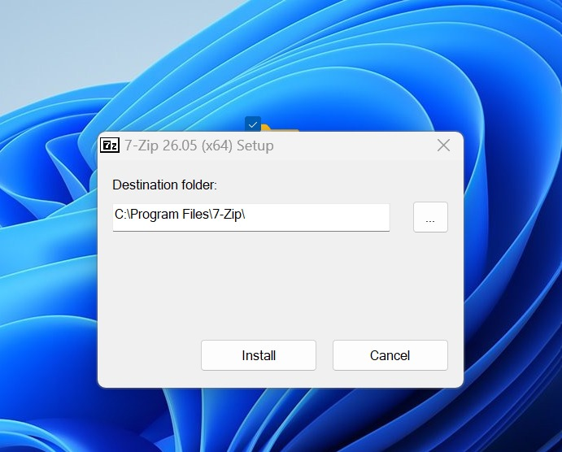
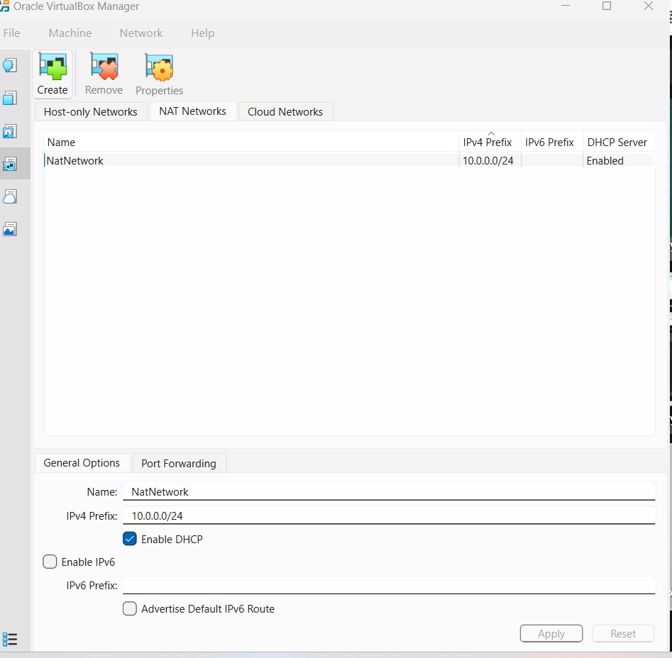
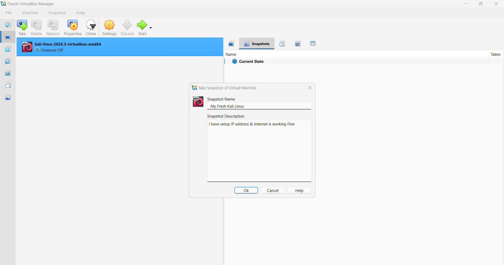
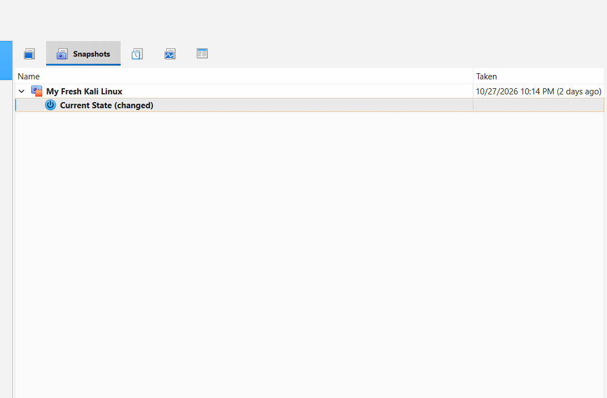

# Cybersecurity Lab Environment Setup

**Building an isolated virtual lab for penetration testing and ethical hacking practice**
</div>

<p align="center">
  
  
  
  
  
  
  
  
  
  
  
   
</p>


##  Project Overview
This project marks the beginning of my cybersecurity journey through practical labs and hands-on projects.

During Week 1, I focused on setting up and configuring my virtual lab environment using **Oracle VirtualBox and Kali Linux**.

Having this environment ready gives me a safe space to practice cybersecurity skills, explore networking, experiment with different security tools, and gradually build the practical experience needed for future penetration-testing projects.

##  Objectives

The main objectives of this project are to:

* Install and configure 7-Zip
* Install Oracle VirtualBox
* Create a VirtualBox NAT Network
* Download and import Kali Linux
* Connect Kali Linux to the lab network
* Configure and verify Kali Linux networking
* Create a clean Virtual Machine snapshot
* Document the complete lab setup
* Prepare the environment for future cybersecurity projects

##  Purpose of the Lab
The main purpose of this lab is to build a safe and controlled environment where I can learn cybersecurity concepts and develop practical, hands-on skills.

I will use this virtual lab for different cybersecurity exercises and projects, including:

- Network reconnaissance
- Network scanning and enumeration
- Vulnerability assessment
- Network traffic and packet analysis
- Exploring and practicing security tools
- SOC-related exercises and security monitoring
- Practical cybersecurity labs
- Authorized penetration testing

This lab will help me improve my technical skills, gain practical experience, and develop the knowledge needed to pursue a career in cybersecurity.

>  **Important:**
> This laboratory is designed for learning, practice, and authorized security testing only. All cybersecurity tools and techniques will be used responsibly and only on systems I own or have received explicit permission to test.
>
> ##  Lab Configuration

| 🧩 Component       | ⚙️ Configuration   |
| ------------------ | ------------------  |
| 🖥️ Host OS         | Windows 11         |
| 🧠 Host RAM        | 16 GB               |
| ⚡ Processor       | Intel Core i5      |
| 🧰 Hypervisor      | VirtualBox 7.2.22  |
| 🐉 Security OS     | Kali Linux 2026.3  |
| 🧠 Kali RAM        | 2048 MB            |
| 🌐 Virtual Network | NAT Network        |
| 📡 Network Address | 10.0.0.0/24        |
| 🐧 Kali IP Address | 10.0.0.2/24        |
| 🚪 Default Gateway | 10.0.0.1           |
| 🌍 DNS Server      | 8.8.8.8            |
| 🔮 Future VM Range | 10.0.0.2–10.0.0.99 |


# 🪜 Lab Setup Procedure

## Step 1 – Install 7-Zip

I installed **7-Zip** to extract the Kali Linux virtual machine files, which were provided in a compressed .7z archive.



## step 2 installation oracle virtual box
I successfully installed **Oracle VirtualBox** on my Windows machine. This software will allow me to create and manage virtual machines for my cybersecurity lab. With the installation complete, I am now ready to move on to the next stage of setting up my virtual environment.


# Step 3 – Configure NAT Network

I created a dedicated **NAT Network** in Oracle VirtualBox using the IP address range **10.0.0.0/24**.

This network configuration provides a controlled environment for my cybersecurity lab, allows virtual machines to access the internet, and makes it possible to connect multiple VMs for future networking and cybersecurity exercises.



# Step 4 – Installation and Import Kali-Linux

I downloaded and successfully imported **Kali Linux** into Oracle VirtualBox. I then connected it to the NAT Network configured for my cybersecurity lab.

Kali Linux provides a range of built-in tools that will help me develop practical skills in areas such as:

- Network analysis and monitoring
- Security testing
- Vulnerability assessment
- Digital forensics
- Penetration testing
- Cybersecurity learning and practice

**Result:** Kali Linux was successfully imported into VirtualBox and connected to my lab network. The virtual machine is now ready for upcoming hands-on cybersecurity exercises and practical projects.



# Step 5 – Configure Kali Linux Network

I configured the network settings in Kali Linux to connect the virtual machine to my cybersecurity lab network.

The network configuration was set as follows:

- **IP Address:** 10.0.0.2/24
- **Default Gateway:** 10.0.0.1
- **DNS Server:** 8.8.8.8

After configuring the settings, I checked the network interface to confirm that Kali Linux had received the expected IP address from the virtual network.

This step helps establish network connectivity and prepares the virtual machine for future networking and security exercises.


# Step 6 – Create a Virtual Machine Snapshot

After completing the initial Kali Linux setup, I created a clean snapshot of the virtual machine using Oracle VirtualBox.

This snapshot serves as a backup point, allowing me to restore Kali Linux to its original configured state if something goes wrong during future installations, configuration changes, or cybersecurity experiments.

Having this restore point will make it easier to experiment with different tools and techniques without worrying about permanently affecting my initial setup.

**Result:** A clean snapshot was successfully created, providing a reliable recovery point for my future cybersecurity lab activities.


## 🔎 Lab Verification

After completing the initial setup, I performed several checks to make sure the Kali Linux virtual machine was properly configured and ready for future cybersecurity exercises.

The verification process included checking the network configuration, testing connectivity to the NAT Network gateway and an external IP address, checking DNS resolution, and confirming that the required security tools were installed.

### Verification Checklist

| Test | Command | Expected Result |
|---|---|---|
| 🌐 Check IP address | `ip a` | Correct Kali Linux IP address displayed |
| 📡 Test gateway | `ping 10.0.0.1` | Successful replies from gateway |
| 🌍 Test internet connectivity | `ping 8.8.8.8` | Successful replies from external IP |
| 🔎 Test DNS resolution | `nslookup networkwalks.com` | Domain name resolves successfully |
| 🧰 Verify Nmap installation | `nmap --version` | Nmap version information displayed |
| 🔄 Verify VM snapshot | Restore snapshot and run `ip a` | Original network configuration restored |

### Network Configuration

The following network settings were used during the lab setup:

```text
IP Address:  10.0.0.2/24
Gateway:     10.0.0.1
DNS Server:  8.8.8.8
```

### Verification Outcome

These checks provide a baseline for confirming that the virtual lab is configured correctly. Any failed connectivity or DNS tests will be investigated before moving on to more advanced exercises.

The snapshot also provides a reliable recovery point whenever I need to return to the original Kali Linux configuration.

# 🐞 Problems Encountered & Solutions

During the setup of my cybersecurity lab, I encountered a few configuration and setup challenges. Documenting these issues and their solutions is an important part of the learning process because troubleshooting is an essential skill in IT and cybersecurity.

### Problem 1 – Network Configuration

I reviewed the network adapter settings in Oracle VirtualBox to make sure that Kali Linux was properly connected to the configured NAT Network.

I also checked the IP address, gateway, and DNS settings to understand how the virtual machine communicates with the network.

### Problem 2 – Maintaining a Clean Lab Environment

To avoid losing my initial configuration during future experiments, I created a snapshot of the Kali Linux virtual machine after completing the basic setup.

This provides a restore point that allows me to return to the original environment whenever configuration changes or testing activities cause unexpected issues.

# 💡 What I Learned

During Week 1, I gained practical experience in setting up the foundation of a virtual cybersecurity laboratory.

### Technical Skills Developed

1. Installing and using 7-Zip to extract compressed files.
2. Installing and configuring Oracle VirtualBox.
3. Understanding how virtualization supports cybersecurity training.
4. Creating and configuring a NAT Network in VirtualBox.
5. Downloading and importing Kali Linux as a virtual machine.
6. Connecting virtual machines to a dedicated virtual network.
7. Checking and understanding Kali Linux network configurations.
8. Creating and restoring virtual machine snapshots.

This first week gave me a better understanding of virtualization and network configuration while preparing me for more advanced, hands-on cybersecurity activities in the coming weeks.

## 🔐 Security & Ethical Use

This laboratory is designed for educational purposes, practical learning, and authorized security testing only.

All cybersecurity tools and techniques will be used responsibly and only against systems I own or have explicit permission to test.

## 🔗 Tools & Technologies

The following tools and platforms were used to build this cybersecurity lab:

- **Windows 11** – Host Operating System
- **Oracle VirtualBox** – Virtualization Platform
- **Kali Linux** – Cybersecurity Operating System
- **7-Zip** – Archive Extraction and File Management
- **GitHub** – Project Documentation and Version Control

## 👤 Author

**Abdikani Mohamud Jeite**

Cybersecurity & IT Support Specialist

- **Program:** Networkwalks
- **Batch:** B084
- **Week:** 01

### LinkedIn

[Abdikani Mohamud Jeite](https://www.linkedin.com/in/abdikani-jeite-8a714a262?utm_source=share_via&utm_content=profile&utm_medium=member_ios/)

## 📌 Project Information

- **Status:** ✅ Completed – Week 1
- **Program:** Cybersecurity at Networkwalks
- **Week:** 01
- **Project:** Cybersecurity & Penetration Testing Lab Setup

This project marks the first step in building my practical cybersecurity skills. It establishes the foundation for upcoming hands-on labs, security exercises, penetration-testing practice, and continuous development of my GitHub portfolio.
